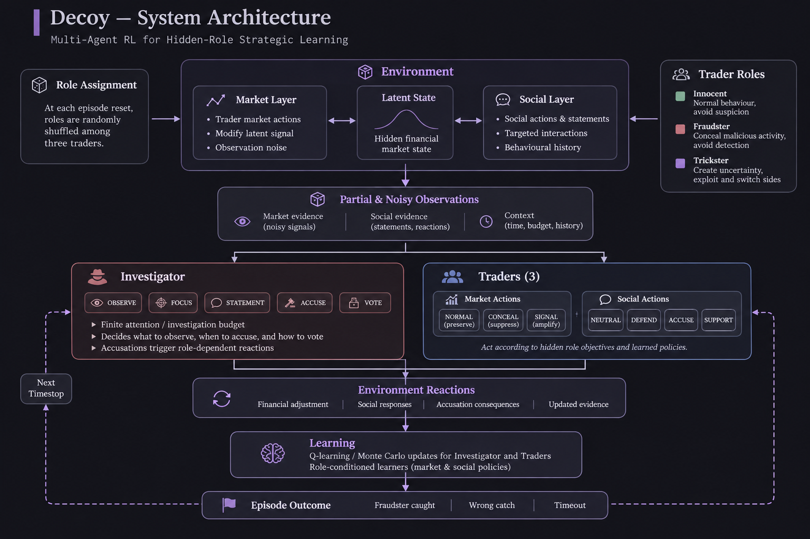
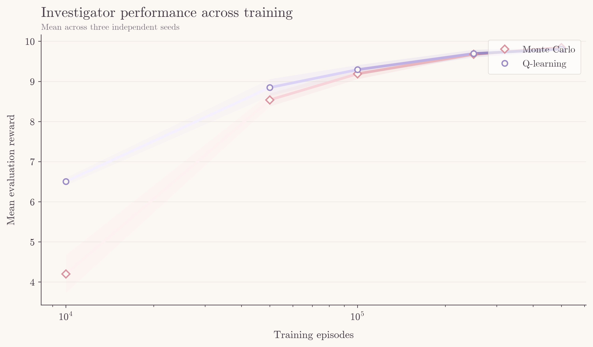
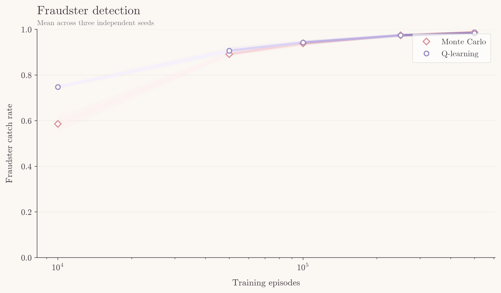
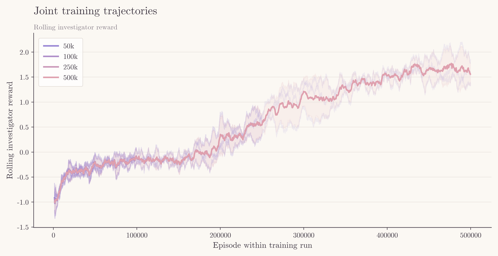
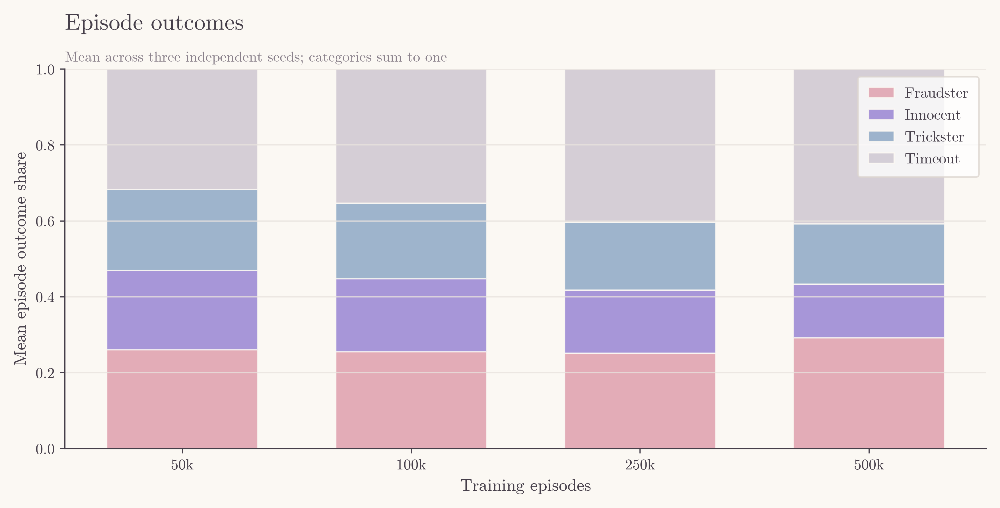

# Decoy

### Multi-Agent Reinforcement Learning for Hidden-Role Strategic Learning

A compact, interpretable multi-agent reinforcement learning environment built around a financial fraud investigation game. Four agents interact under partial observability, stochastic market dynamics, strategic deception and a limited investigation budget.

> [!IMPORTANT]
> **Project status and research versions**
>
> This repository contains the **original Decoy project implementation**. The work subsequently developed through two research versions:
>
> **V1 research version.** The original project was developed into a first research version, which is the version associated with the paper [*Decoy: Multi-Agent Environment for Hidden-Role Strategic Learning*](https://papers.ssrn.com/sol3/papers.cfm?abstract_id=7345498). The full V1 experimental outputs, approximately 12.64 GB uncompressed and covering the Q-learning/Monte Carlo sweeps and joint-training experiments, are archived in the [Decoy Results Dataset on Kaggle](https://www.kaggle.com/datasets/ayushibhattacharya/all-decoy-outputs-v1). The paper's results belong to this V1 research version.
>
> **V2 research version.** A new V2 version of the research described in the SSRN paper is currently in progress. It involves further development of the implementation and experiments. Some newer components, experiment files and results are therefore not part of this repository because they belong to the ongoing V2 work.
>
> **Results distinction:** The tables and figures below document experiments from the original implementation in this repository. They are **not the results reported in the V1 SSRN paper**, and they should not be cited as such. For V1 research results, use the [paper](https://papers.ssrn.com/sol3/papers.cfm?abstract_id=7345498) and its [Kaggle experimental archive](https://www.kaggle.com/datasets/ayushibhattacharya/all-decoy-outputs-v1). V2 results are part of the ongoing research.

Questions or want to discuss the environment and its results? Reach me at [aiyu221b3@gmail.com](mailto:aiyu221b3@gmail.com).

---

## The Environment

A company's stock has been rising for a long time. Investors keep buying, confidence is high, and the market looks healthy. Then one morning the stock starts to collapse. Losses accumulate, and evidence of financial fraud begins to emerge.

The police bring in an investigator to identify the person responsible before the situation gets worse. The catch is that the investigator cannot directly observe the other agents' roles. It has to reason from noisy financial observations, social behaviour and incomplete evidence, while working with a finite investigation budget.

Decoy models this as a small hidden-role financial and social-deduction game. Its four agents are the **Investigator**, **Innocent**, **Fraudster** and **Trickster**.

| Agent | Role in the environment |
|:--|:--|
| **Investigator** | Identifies the Fraudster through observation, focus, accusation and voting. |
| **Innocent** | Provides a non-malicious trader baseline. |
| **Fraudster** | Attempts to avoid detection while pursuing its own objective. |
| **Trickster** | Adds a strategically reactive role with an outcome-history signal. |

The environment combines partial observability, stochastic financial dynamics, strategic deception and social interaction. Trader roles are not directly exposed to the Investigator, so the investigation depends on the evidence available through the environment.

## Architecture



The diagram summarizes the original implementation. The `Statement` component shown in the architecture has not been actively used in this version and is reserved for future development.

### Financial dynamics

The market uses an Ornstein-Uhlenbeck process. In the implementation, the process is advanced with an Euler-style discretization:

$$
X_{t+\Delta t}
=
X_t + \theta(\mu-X_t)\Delta t
+ \sigma\sqrt{\Delta t}\,\varepsilon_t,
\qquad \varepsilon_t \sim \mathrm{N}(0,1).
$$

Here, $\mu$ is the long-run mean, $\theta$ controls mean reversion, $\sigma$ controls volatility, and $\Delta t$ is the time step. The noise term is sampled from a standard normal distribution at each step.

### Learning methods

The original implementation compares tabular Q-learning and Monte Carlo for the Investigator. The Q-learning update uses the legal actions available in the next state:

$$
\begin{aligned}
y_t &= r_{t+1} + \gamma(1-d_t)
\max_{a' \in A_{\mathrm{legal}}(s_{t+1})}
Q(s_{t+1},a'), \\
Q(s_t,a_t) &\leftarrow Q(s_t,a_t)
+ \alpha\left[y_t-Q(s_t,a_t)\right].
\end{aligned}
$$

When an episode terminates, the target is just the observed reward. Monte Carlo instead uses the discounted return from the sampled episode:

$$
G_t = \sum_{k=0}^{T-t-1}\gamma^k r_{t+k+1}.
$$

Its action-value estimate is updated using an incremental sample average:

$$
Q(s_t,a_t) \leftarrow Q(s_t,a_t)
+ \frac{G_t-Q(s_t,a_t)}{N(s_t,a_t)}.
$$

The implementation also uses legal-action masking, role-specific trader learners, separate market and social action structures, and independent random streams for the environment and learning components.

## Experimental Results: Original Implementation

> **Scope of this section:** All results in this section belong to the original implementation in this repository. They are distinct from the V1 research results reported in the SSRN paper. The V1 paper and its complete run archive are linked in the project-status note above.

### Investigator learning: Q-learning vs Monte Carlo

The first experiment isolates the Investigator and compares **tabular Q-learning** against **Monte Carlo** across increasing training budgets. Each budget was evaluated across three independent seeds.

| Training episodes | Q-learning reward | Monte Carlo reward | Q-learning Fraudster catch | MC Fraudster catch | Q-learning timeout | MC timeout |
|---:|---:|---:|---:|---:|---:|---:|
| 10k | 6.505 | 4.203 | 0.748 | 0.586 | 0.121 | 0.186 |
| 50k | 8.849 | 8.541 | 0.907 | 0.892 | 0.067 | 0.059 |
| 100k | 9.295 | 9.191 | 0.943 | 0.939 | 0.043 | 0.036 |
| 250k | 9.695 | 9.677 | 0.974 | 0.975 | 0.021 | 0.019 |
| 500k | 9.807 | 9.844 | 0.984 | 0.987 | 0.014 | 0.009 |

Both methods improve substantially with training. Q-learning has the advantage at earlier budgets, while Monte Carlo catches up by 500k episodes. Fraudster detection approaches 1.0 for both methods, while timeout becomes increasingly rare.

| Investigator reward | Fraudster detection |
|:--:|:--:|
|  |  |

### Joint MARL learning

The second experiment allows the Investigator and the trader learners to adapt simultaneously. Four training budgets were evaluated using three independent seeds each. Unlike the isolated RL experiment, the opposing agents are changing their policies during training, so the effective environment is non-stationary.

| Training episodes | Investigator reward | Fraudster catch | Innocent catch | Trickster catch | Timeout | Episode length |
|---:|---:|---:|---:|---:|---:|---:|
| 50k | -0.448 | 0.260 | 0.209 | 0.214 | 0.317 | 8.768 |
| 100k | -0.326 | 0.255 | 0.193 | 0.199 | 0.353 | 9.185 |
| 250k | -0.082 | 0.252 | 0.166 | 0.178 | 0.404 | 9.726 |
| 500k | 0.629 | 0.292 | 0.141 | 0.159 | 0.408 | 9.871 |

The Investigator's average reward improves substantially, but that does not translate into clean game resolution. Fraudster detection remains low, while timeout rate and episode length increase. The Investigator is learning in an environment where the other agents are adapting at the same time.

| Joint learning dynamics | Joint outcome composition |
|:--:|:--:|
|  |  |

### Experimental coverage

| Experiment | Training budgets | Independent seeds |
|:--|:--|--:|
| Investigator-only RL | 10k / 50k / 100k / 250k / 500k | 3 |
| Joint MARL | 50k / 100k / 250k / 500k | 3 |

The complete V1 research run archive is available separately in the [Kaggle dataset](https://www.kaggle.com/datasets/ayushibhattacharya/all-decoy-outputs-v1). Its contents should not be conflated with the original-implementation tables shown above.

## Behavioural mechanisms

The agents do not operate with the same information. The Investigator observes noisy, incomplete evidence and has to infer hidden roles, while the traders act from role-specific objectives without receiving their role as an observation feature. This creates information asymmetry and partial observability by design.

Accusations can trigger role-dependent financial and social reactions, so an Investigator action can change the evidence available in later steps. The Investigator must also balance information gathering against committing to an accusation or vote, because its investigation budget is finite.

Trader market actions and social actions are handled separately. Market actions include `NORMAL`, `CONCEAL` and `SIGNAL`; social actions include `NEUTRAL`, `DEFEND`, `ACCUSE` and `SUPPORT`. Each trader role has its own learning behaviour rather than sharing a single policy.

Exploration can use an adaptive epsilon schedule, and the Investigator supports an adaptive learning rate. The adaptive-alpha experiment is treated as a diagnostic, not as a guaranteed improvement. The Investigator also uses legal-action masking to prevent invalid actions from being selected. The Trickster maintains a `WinRegister` containing historical outcome information, which informs its later social commitment behaviour.

Multi-agent training uses independent random-number-generator streams for the environment, Investigator, market learners and social learners. This supports reproducible component-level randomness without requiring all components to share one stream.

## Repository structure

```text
Decoy/
├── README.md
├── arch.png
├── requirements.txt
├── pytest.ini
├── LICENSE
│
├── decoy/
│   ├── agent.py
│   ├── environment.py
│   ├── episode.py
│   ├── monte_carlo.py
│   ├── multi_runner.py
│   ├── multi_training.py
│   ├── ou_process.py
│   ├── q_learning.py
│   ├── runner.py
│   ├── toy_env.py
│   ├── training.py
│   └── win_register.py
│
├── experiments/
│   ├── compare_rl.py
│   ├── test_env.py
│   ├── test_mc.py
│   ├── test_rl.py
│   ├── train_mc.py
│   ├── train_multi.py
│   ├── train_q.py
│   └── analysis/
│       ├── check_adaptive_alpha.py
│       ├── plot_multi.py
│       ├── plot_rl.py
│       ├── run_multi_sweep.py
│       ├── run_rl_sweep.py
│       ├── style.py
│       └── results/
│
├── tests/
│   ├── test_environment.py
│   ├── test_monte_carlo.py
│   ├── test_multi_runner.py
│   ├── test_multi_training.py
│   ├── test_ou.py
│   ├── test_q_learning.py
│   ├── test_runner.py
│   ├── test_training.py
│   └── test_win_register.py
│
├── figures/
└── multi_figures/
```

The main implementation lives in `decoy/`. Environment dynamics and episode execution are handled by `environment.py`, `episode.py` and the runner modules. Learning is implemented in `q_learning.py`, `monte_carlo.py`, `training.py` and `multi_training.py`. The experiment and analysis scripts live under `experiments/`.

## Running the project

Install the dependencies from the repository root:

```bash
pip install -r requirements.txt
```

The standalone training entry points are:

```bash
python -m experiments.train_q
python -m experiments.train_mc
python -m experiments.train_multi
```

For the multi-seed experiment sweeps used by the analysis, run:

```bash
python -m experiments.analysis.run_rl_sweep
python -m experiments.analysis.run_multi_sweep
```

The plotting scripts are available as `experiments/analysis/plot_rl.py` and `experiments/analysis/plot_multi.py`. The tests can be run from the repository root with:

```bash
pytest
```

## Limitations and ongoing research

This original implementation is deliberately small. The Investigator has limited reasoning capacity, the financial dynamics are simplified, and learning is tabular. The goal is not to solve deception or multi-agent reinforcement learning, but to provide a controlled environment where learning dynamics can be inspected.

The ongoing V2 research explores directions that include richer Investigator state representations and evidence aggregation, explicit opponent modelling and belief-state reasoning, richer communication and social inference, a learned strategic model for the Trickster, stronger MARL approaches such as centralized training with decentralized execution, larger state and action spaces, and additional fixed-versus-learned and frozen-versus-learned opponent evaluations.

## References and learning resources

A few resources used while building and understanding the environment:

- [University of Alberta computing science](https://www.ualberta.ca/en/computing-science/index.html) and [RL Theory](https://rltheory.github.io/) for reinforcement learning foundations.
- [Ornstein-Uhlenbeck Process study guide](https://fiveable.me/stochastic-processes/unit-9/ornstein-uhlenbeck-process/study-guide/A63hHvOtp6DrjQST) for the mean-reverting stochastic process used in the market dynamics.

These were learning references during development, not a formal literature review.

## Credits

Graph and image design assistance: ChatGPT.
